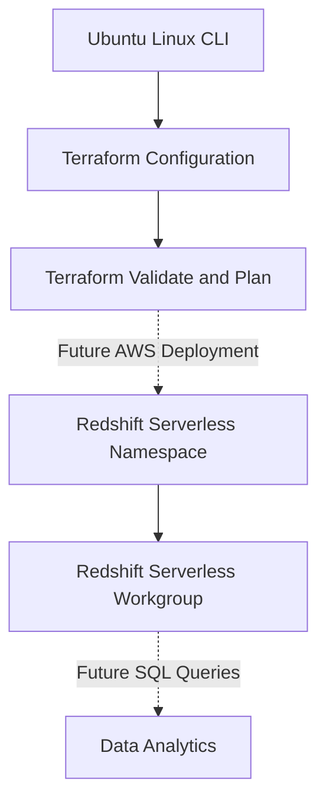

# Amazon Redshift Serverless Terraform Lab

## Project Overview

This project demonstrates how to use Terraform, AWS CLI, Ubuntu Linux, and Git to plan an Amazon Redshift Serverless analytics environment in AWS `us-east-1`.

**Project status: PLAN ONLY — no AWS resources deployed.**

## Architecture



The namespace and workgroup are planned resources, not deployed infrastructure.

## Technologies

- Amazon Redshift Serverless
- AWS CLI
- Terraform 1.17.0
- Ubuntu Linux
- Git and GitHub

## Planned Infrastructure

| Terraform Resource | Configuration | Status |
|---|---|---|
| `aws_redshiftserverless_namespace.lab` | Namespace: `terraform-redshift-lab` | Planned |
| `aws_redshiftserverless_workgroup.lab` | Workgroup: `terraform-redshift-lab` | Planned |

## Redshift Configuration

- AWS region: `us-east-1`
- Namespace: `terraform-redshift-lab`
- Database: `analyticsdb`
- Workgroup: `terraform-redshift-lab`
- Base capacity: 8 RPUs
- Public accessibility: Disabled
- Administrator password: Managed by Redshift

The project does not configure a custom VPC, subnet group, database tables, or SQL workloads.

## AWS Discovery

Read-only AWS CLI discovery returned:

- Provisioned Redshift clusters: `0`
- Redshift Serverless workgroups: `0`

## Terraform Validation

Commands:

```bash
terraform init
terraform fmt
terraform validate
terraform plan -input=false -no-color
```

Observed results:

```text
Success! The configuration is valid.

Plan: 2 to add, 0 to change, 0 to destroy.
```

## Deployment Status

No `terraform apply` was executed.

No Redshift namespace or workgroup was deployed by this project.

No SQL queries or analytics workloads were executed.

## Security and Cost

- Public access is disabled in the planned workgroup.
- Administrator password management is delegated to Redshift.
- Terraform state and variable files must not be committed to GitHub.
- AWS credentials and private keys must never be published.
- Redshift Serverless can incur substantial compute and storage charges if deployed.
- Network configuration and access controls require review before production deployment.

## Future Improvements

- Review VPC and subnet requirements.
- Deploy to a controlled test environment after authorization.
- Configure appropriate IAM permissions.
- Connect to Redshift using SQL tools.
- Load sample data from Amazon S3.
- Run SQL queries and analyze results.
- Monitor usage and cost.

## Validation Evidence

See `docs/validation-evidence.md` and `screenshots/redshift-terraform-validation.png`.

